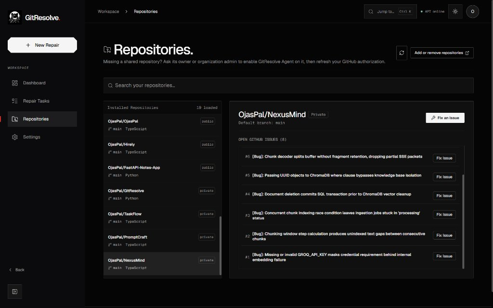
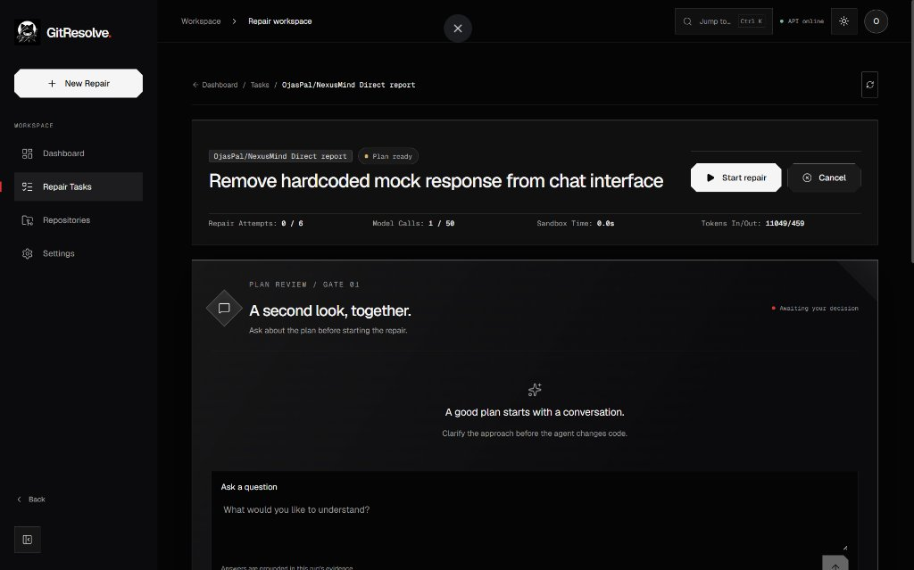
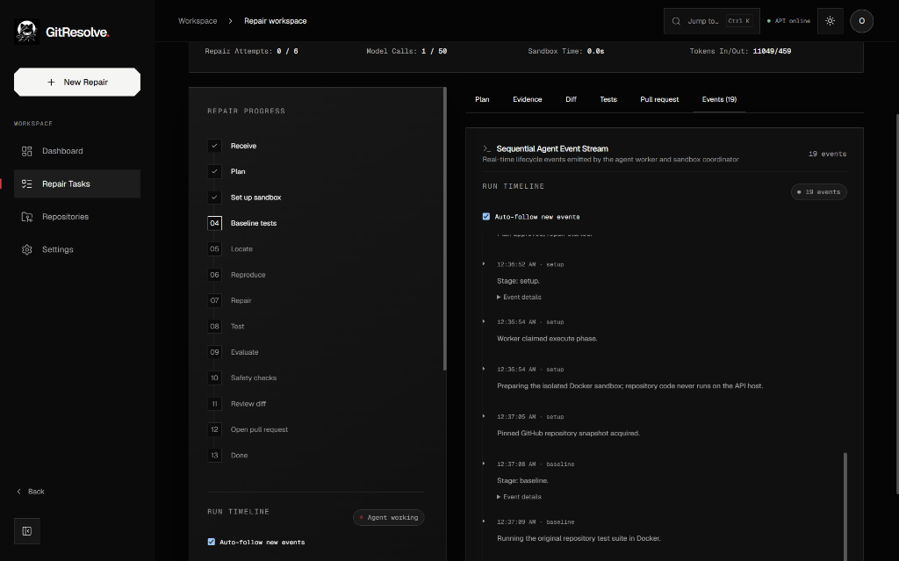
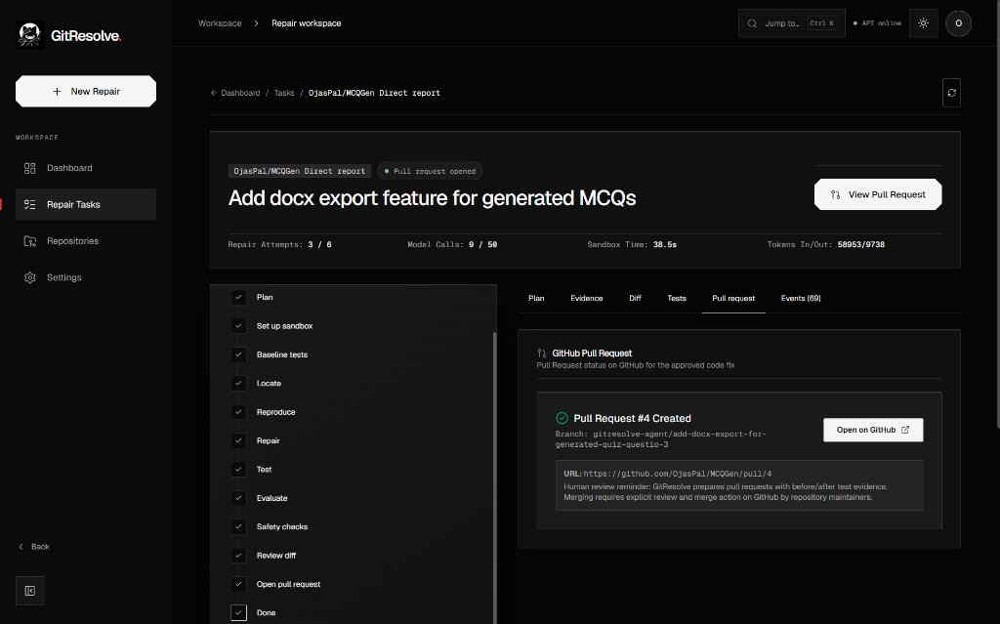
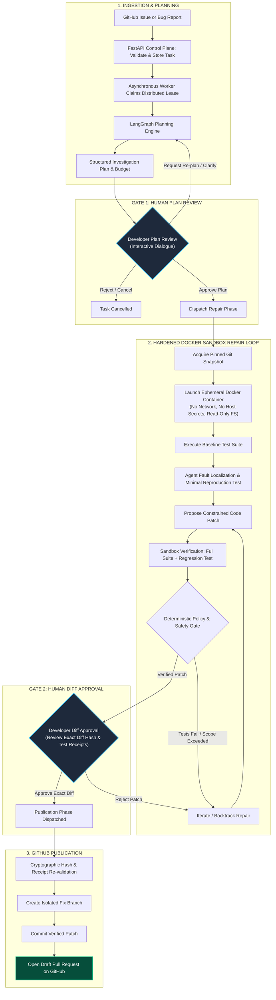

<div align="center">


# GitResolve

### Investigate issues. Verify fixes. Keep humans in control.

GitResolve is an autonomous, verification-centric AI issue investigation and repair platform for Python repositories. It analyzes issues, builds an actionable investigation plan, reproduces faults, verifies candidate patches in a hardened Docker sandbox, and creates draft GitHub pull requests only after explicit human approval.

<p align="center">
  <a href="https://gitresolve-agent.vercel.app/" target="_blank">
    
  </a>
</p>

<p align="center">
  
  &nbsp;
  
  &nbsp;
  
  &nbsp;
  
  &nbsp;
  
</p>

<p align="center">
  <a href="#what-it-does">Overview</a> &bull;
  <a href="#visual-showcase">Showcase</a> &bull;
  <a href="#agentic-workflow--verification-architecture">Workflow Architecture</a> &bull;
  <a href="#architecture--components">Components</a> &bull;
  <a href="#production-deployment-architecture">Deployment</a> &bull;
  <a href="#getting-started">Run Locally</a>
</p>

</div>

---

## What it does

GitResolve turns a GitHub issue or a direct bug report into a reviewable, fully-tested repair workflow. It gathers repository context, develops an investigation plan, checks whether the reported failure can be reproduced, and validates a proposed patch inside an isolated Docker sandbox before asking for approval.

The workflow has two explicit human gates:

1. **Gate 1 — Approve the plan** before repair execution begins. Developers can engage in interactive multi-turn dialogue with the agent to clarify constraints or refine the approach.
2. **Gate 2 — Approve the exact verified diff** before GitHub publication. Developers inspect the full diff, reproduction evidence, and test receipts.

Approval is cryptographically bound to the diff hash that was reviewed. Any subsequent change invalidates the approval and requires re-verification. GitResolve creates **draft pull requests**; it never auto-merges into target repositories.

---

## Visual Showcase

<div align="center">

### 1. Connected Repositories & Real-Time Issue Sync
Select from your installed GitHub repositories, inspect open issues, and trigger repairs with a single click.



<br /><br />

### 2. Gate 1: Conversational Plan Review
Before any code changes occur, review the agent's structured investigation plan, budget allocation, and discuss adjustments in natural language.



<br /><br />

### 3. 13-Stage Agent Execution & Live Event Stream
Watch the agent worker execute baseline tests, fault localization, test reproduction, and patch generation with real-time streaming telemetry.



<br /><br />

### 4. Draft Pull Request Created
Inspect the verified diff hash and test receipts. Upon your authorization, GitResolve publishes a clean draft Pull Request to GitHub.



</div>

---

## Agentic Workflow & Verification Architecture



---

## Architecture & Components

GitResolve separates the user-facing web application, control plane, asynchronous agent worker, external integrations, and repository execution boundary. The API coordinates requests and persists task state; repository code is run exclusively inside hardened Docker containers.

### Component Responsibilities

| Component | Responsibility | Isolation Boundary |
| --- | --- | --- |
| [Frontend](frontend/README.md) | Next.js 14 web client: Firebase Google auth, GitHub installation flow, task timeline, interactive plan review, and diff inspection. | Firebase sign-in and backend GitHub sessions are strictly decoupled. The browser never receives GitHub App private keys. |
| [API](backend/app/api/) · [backend guide](backend/README.md) | FastAPI control plane: versioned REST API, request validation, authentication, ownership checks, task lifecycle, and event streaming. | Never executes repository code. Dispatches jobs to durable persistence without blocking on execution. |
| [Services](backend/app/services/) · [store](backend/app/services/store/) | Task transitions, policy enforcement, GitHub access management, and persistence abstractions. | Firestore access is isolated behind typed store interfaces. Repository permissions are validated directly against GitHub. |
| [Worker](backend/app/worker/) | Background runner: claims plan, execute, and publication phases; maintains distributed leases; handles cancellation. | Runs outside API request threads; production deployments run on dedicated VM instances sharing durable Firestore storage. |
| [Agent runtime](backend/app/agent/) · [model router](agent/router.py) | Dual LangGraph workflows (planning & repair), typed state, tool schemas, and task-scoped token budgets. | Agent output constitutes evidence/proposals; backend policy gates determine task transitions. Model calls route through `ModelRouter`. |
| [GitHub integration](githubapp/) · [setup guide](docs/GITHUB_INTEGRATION.md) | Installation-scoped OAuth tokens, repository syncing, and PR publication. | Publication re-validates the approved diff hash, base SHA, and trusted Docker verification receipt. |
| [Sandbox](sandbox/README.md) | Hardened execution runner: acquires pinned repository snapshots, prepares wheel dependencies, and runs tests in Docker. | Receives no host credentials or Docker socket; execution runs with network disabled. |

---

## Production Deployment Architecture

GitResolve is architected as a resilient, decoupled cloud system deployed across Google Cloud Platform and Vercel:

```
┌─────────────────────────────────┐
│        Next.js 14 Frontend      │   (Vercel Edge Network)
│  gitresolve-agent.vercel.app    │
└────────────────┬────────────────┘
                 │ HTTPS / REST (with Firebase Bearer Token)
                 ▼
┌─────────────────────────────────┐
│       FastAPI Control Plane     │   (Google Cloud Run)
│   Stateless API Service         │
└───────┬─────────────────┬───────┘
        │                 │
        │ Distributed     │ ACID Task State & Events
        │ Lease Polling   ▼
        │        ┌─────────────────────────┐
        │        │  Google Cloud Firestore │
        │        │  (Transactional Store)  │
        │        └────────▲────────────────┘
        ▼                 │
┌─────────────────────────┴───────┐
│     GitResolve Agent Worker     │   (Google Compute Engine VM - e2-standard-4)
│  Async Worker Daemon + Docker   │
│  ┌───────────────────────────┐  │
│  │ Hardened Docker Sandbox   │  │
│  │ (Isolated Container Exec) │  │
│  └───────────────────────────┘  │
└────────────────┬────────────────┘
                 │
                 ▼
┌─────────────────────────────────┐
│    External Provider APIs       │
│  • Google GenAI (Gemini Flash)  │
│  • GitHub App API (Octokit)     │
└─────────────────────────────────┘
```

- **Frontend on Vercel**: Hosted at [`gitresolve-agent.vercel.app`](https://gitresolve-agent.vercel.app/), delivering edge-cached static assets, dark-mode terminal aesthetics, and reactive polling for real-time lifecycle event logs.
- **API on Google Cloud Run**: Containerized FastAPI service with automated HTTPS, autoscaling, and secure environment variable injection via Google Secret Manager.
- **Worker on Google Compute Engine (GCE)**: Dedicated Ubuntu VM (`e2-standard-4`) hosting the persistent background daemon and the local Docker daemon required for untrusted repository code execution.
- **Persistence on Google Cloud Firestore**: Central document database enforcing ACID transactions for distributed worker leases, task status transitions, and immutable event streams.
- **LLM Routing via Google GenAI**: Powered by Gemini 2.5 and 3.8 Flash via a specialized `ModelRouter` enforcing per-task token quotas, bounded retries, and fallback handling.

---

## Safety and Support Boundaries

- **Untrusted Inputs**: Model responses and repository contents are treated as untrusted input.
- **Independent Policy Gates**: Deterministic scope and diff checks, verification receipts, and backend approval gates—not model confidence—control whether a patch can be published.
- **Container Isolation**: Repository commands and tests run in Docker, never on the API or worker host. Execution containers run with network disabled and receive no host credentials.
- **Diff Hash Integrity**: The exact SHA-256 hash of the unified diff approved by the developer must match the publication payload byte-for-byte.
- **Supported Targets**: Currently optimized for Python 3.12 repositories on Linux x86-64 using `pytest` and Streamlit `AppTest`.

---

## Getting Started

### Prerequisites

- Python 3.12 and [`uv`](https://docs.astral.sh/uv/)
- Node.js 18+ and npm
- Docker with Linux container support

### Install Dependencies

From the repository root, install the Python environment:

```shell
uv sync --group dev
```

Install frontend dependencies:

```shell
cd frontend
npm ci
```

### Run Local Development Services

1. **Start the API backend** (from repository root):
   ```shell
   uv run python -m uvicorn app.main:app --app-dir backend --reload --host 127.0.0.1 --port 8000
   ```

2. **Start the frontend** (from `frontend/`):
   ```shell
   npm run dev
   ```

3. **Verify endpoints**:
   - Web application: `http://localhost:3000`
   - API health check: `http://localhost:8000/health`

---

## Development Checks

Run the backend test suite:

```shell
uv run pytest -q
```

Run frontend linting, typechecking, and production build:

```shell
npm --prefix frontend run lint
npm --prefix frontend run build
```

---

## Documentation

### Core Guides
- [Frontend README](frontend/README.md) — UI architecture, authentication, and state management
- [Backend README](backend/README.md) — API endpoints, worker lifecycle, and persistence store
- [Sandbox README](sandbox/README.md) — Execution contract, Docker profiles, and security boundaries
- [GitHub App Integration](docs/GITHUB_INTEGRATION.md) — App manifest, webhook setup, and token exchange

### Specifications & Compliance
- [Product Requirements (PRD)](docs/GitResolve_PRD.md)
- [Technical Requirements (TRD)](docs/GitResolve_TRD.md)
- [Application Flow Document (AFD)](docs/GitResolve_AFD.md)
- [Backend Schema & Lifecycle Contract](docs/GitResolve_Backend_Schema.md)
- [UI/UX Design Brief](docs/GitResolve_UI_UX_Design_Brief.md)
- [Help & Troubleshooting Content](docs/GitResolve_Help_Content.md)
- [Data Retention & Deletion Policy](docs/DATA_RETENTION_AND_DELETION.md)
- [Privacy Policy](docs/PRIVACY_POLICY.md)
- [Terms of Service](docs/TERMS_OF_SERVICE.md)

---

## Repository Layout

```text
agent/       Model routing and shared agent utilities
assets/      Brand assets and application screenshots
backend/     FastAPI application, worker daemon, and test suites
docs/        System architecture, schemas, and compliance specifications
frontend/    Next.js 14 web application
githubapp/   GitHub App integration and publication services
sandbox/     Docker execution runner and verification profiles
scripts/     Operational and deployment scripts
```

---

## License

### All rights reserved.

GitResolve is publicly available for viewing and evaluation purposes. No open-source license is granted. Unauthorized copying, modification, redistribution, or commercial use of the source code is not permitted, except as allowed by applicable law or GitHub's Terms of Service.
