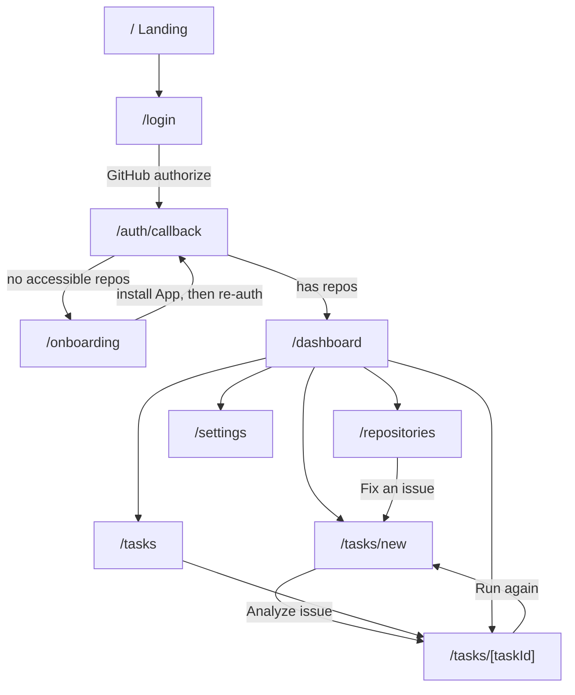
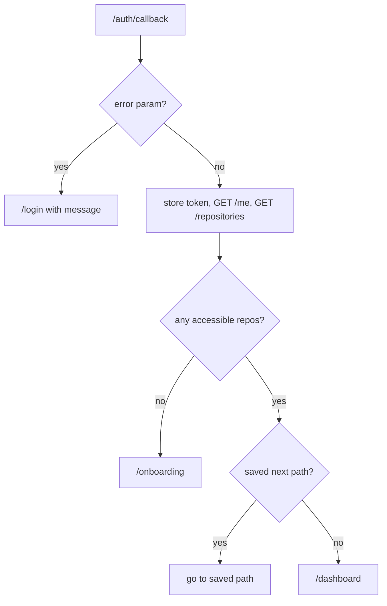
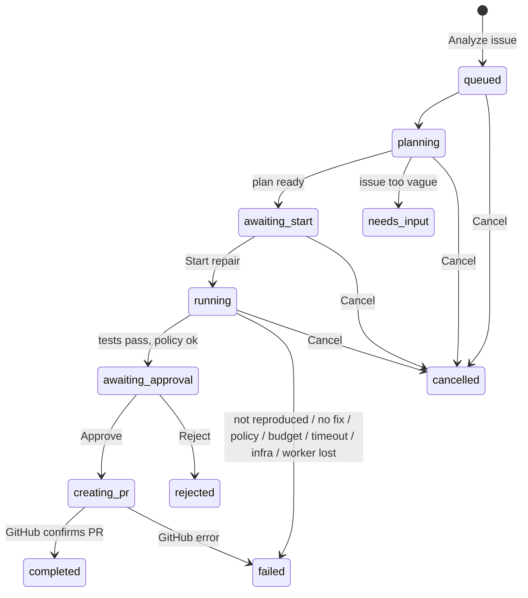

# GitResolve: App Flow Document (AFD)

**Version:** 1.0 | **Status:** Draft for review | **Doc 3 of 6** | Save as `docs/AFD.md`
**Sources:** `docs/PRD.md` and `docs/TRD.md` (both frozen). If this document conflicts with them, section 2 lists the conflict and the resolution.

> This document answers one question: **what does the user see, where can they go, and what happens after each action?** It covers pages, routes, access rules, states, and journeys. It does not cover visual design (Doc 4) or data schemas (Doc 5).

---

## 1. Purpose and Scope

**In scope (MVP):** public landing, GitHub sign-in, onboarding, dashboard, repositories, task list, new repair, task details (including plan review, fix review, approval and PR result), settings, error pages.

**Out of scope (DEFERRED):** team/org views, free-text bug descriptions, notifications by email or push, task deletion/archiving, in-app account deletion, mobile-specific screens (the layout is responsive, nothing more).

**Guiding UX decisions**

1. The **dashboard is home base**, and every repair task has a **persistent detail page**. The agent runs on a worker, so closing the browser never stops a task; returning later shows its current state.
2. **Two human gates, both explicit:** (a) *Start repair* after reviewing the plan; (b) *Approve & create PR* after reviewing the exact diff and test evidence. GitResolve never merges.
3. **One primary workflow.** Fewer pages, with stage-aware sections inside the task page instead of a route per step.

---

## 2. Refinements and Cross-Document Issues

The pasted draft was kept as the base. These are the changes made so it matches the PRD and TRD.

| # | Draft said | Problem | Resolution in this AFD |
|---|-----------|---------|------------------------|
| R-1 | "Review proposed fix → Open GitHub PR" | PRD/TRD require human approval **before** the PR exists | Fix review ends with **Approve & create PR** (or Reject). The PR link appears only after GitHub confirms creation |
| R-2 | "Enter GitHub issue **or bug description**" | TRD API is `POST /tasks {repoId, issueNumber}`; PRD scope is issues | MVP supports **selecting an existing GitHub issue only**. Free-text description is DEFERRED |
| R-3 | "Review task configuration → Start" | TRD has a plan stage (`awaiting_start`) | New Repair creates the task and lands on its page; the plan is reviewed there, then the user clicks **Start repair** |
| R-4 | Separate "Fix Review" screen and "Task History" screen | Extra routes with the same data | Review is a section of `/tasks/[taskId]`. Task History **is** `/tasks` |
| R-5 | "Connect GitHub / OAuth" | TRD uses a **GitHub App**: sign-in and repository access are two steps | Onboarding = sign in, then **install the App** on chosen repositories |
| R-6 | Settings: "Disconnect" | Account deletion is DEFERRED; token revocation happens on GitHub | Settings shows the account, a link to manage access on GitHub, and Sign out |
| R-7 | "Protected routes enforced by backend" | Correct, but TRD uses a Bearer JWT in `sessionStorage`, so Next.js middleware **cannot** read it | Frontend uses a client-side **AuthGate** for UX only. Real enforcement is the backend returning `401`/`403`/`404` |

**Gaps found in the TRD (need a small TRD update, not a scope change):**

| # | Gap | Proposed fix | Status |
|---|-----|--------------|--------|
| G-1 | OAuth callback failure (`400`/`502`) would show raw JSON on the backend URL | Backend **redirects** to `FRONTEND_URL/auth/callback?error=<code>` instead | **OPEN DECISION**, recommended |
| G-2 | TRD discards the GitHub user token after login, so after the user installs the App (or changes repos) the backend cannot re-list installations | After install or "Refresh access", the frontend re-runs the sign-in redirect (GitHub skips the prompt for an already-authorized app), which re-syncs installations and issues a new JWT | **OPEN DECISION**, recommended |
| G-3 | PR creation can fail after approval (`failed_infra`), but there is no endpoint to retry; `approve` returns `409` outside `awaiting_approval` | Allow `approve` again from `failed_infra` when `finalDiffHash` is set, or add `POST /tasks/{id}/retry-pr` | **OPEN DECISION** |
| G-4 | `needs_input` has no way to answer the agent's question | MVP: terminal state; user edits the issue on GitHub and runs again | Decided |
| G-5 | `GET /tasks` has no filter parameters | MVP filters (status, repository) are applied **client-side** on the loaded page | Decided |

---

## 3. Page and Screen Hierarchy

| Screen | Contents | Route |
|--------|----------|-------|
| Landing | Value proposition, 6-step "how it works", safety principles, Sign in CTA | `/` |
| Sign in | GitHub button, plain-language access explanation | `/login` |
| Auth callback | Transient: stores token, routes the user, shows errors | `/auth/callback` |
| Onboarding | Step list, install GitHub App, access explanation | `/onboarding` |
| Dashboard | Needs-attention list, active tasks, recent tasks, New Repair CTA | `/dashboard` |
| Repositories | Accessible repos, add/remove access (on GitHub), fix-an-issue shortcut | `/repositories` |
| Repair Tasks (history) | All tasks, client-side filters, outcomes | `/tasks` |
| New Repair | Pick repository, pick issue, confirm | `/tasks/new` |
| Task Details | Status, plan, live timeline, evidence, diff review, approval, PR result | `/tasks/[taskId]` |
| Settings | Account, GitHub access link, sign out | `/settings` |
| Not Found / Error | Recovery actions | `not-found`, `error` |

---

## 4. Navigation Layout and Active States

**Signed-in shell:** left sidebar (collapses to a top bar with a drawer on narrow screens) + top bar with the user avatar menu (Settings, Sign out).

| Sidebar item | Route(s) highlighted | Notes |
|--------------|----------------------|-------|
| **New Repair** (primary button) | `/tasks/new` | Always visible |
| Dashboard | `/dashboard` | Default landing after sign-in |
| Repositories | `/repositories` | |
| Repair Tasks | `/tasks`, `/tasks/[taskId]` | Breadcrumb on detail: `Repair Tasks / owner/repo #42` |
| Settings | `/settings` | Also reachable from avatar menu |

- A small **attention dot** on Repair Tasks shows when the loaded task list contains `awaiting_start` or `awaiting_approval`. The list refreshes on page load, window focus, and a manual refresh button. There is **no global background polling** (each list read costs Firestore reads; see TRD 7.6).
- Public pages (`/`, `/login`) use a minimal top bar with Sign in.

---

## 5. Routes, Access, and Authentication

### 5.1 Route table

| Route | Access | Backend calls (TRD 6.2) | Behavior |
|-------|--------|-------------------------|----------|
| `/` | Public | none | If a valid token exists, show "Go to dashboard" instead of Sign in |
| `/login` | Public | `GET /auth/github/login` (redirect) | Already signed in → redirect to `/dashboard`. Reads `?error=` and `?next=` |
| `/auth/callback` | Auth flow | `GET /me` | Reads `#token=` from the URL fragment, stores it, **removes the fragment** (`history.replaceState`), then routes (5.3). Reads `?error=` (G-1) |
| `/onboarding` | Protected | `GET /me`, `GET /repositories` | Shown when the user has no accessible repositories |
| `/dashboard` | Protected | `GET /tasks`, `GET /repositories` | Home |
| `/repositories` | Protected | `GET /repositories` | |
| `/tasks` | Protected | `GET /tasks` (paged) | History |
| `/tasks/new` | Protected | `GET /repositories`, `GET /repositories/{id}/issues`, `POST /tasks` | Optional prefill: `?repo=<repoId>&issue=<number>` |
| `/tasks/[taskId]` | Protected + owner | `GET /tasks/{id}`, `/events`, `/artifacts`, plus `start`, `cancel`, `approve`, `reject` | |
| `/settings` | Protected | `GET /me` | |

`/tasks/new` and `/tasks/[taskId]` coexist: the static segment `new` wins in Next.js routing, and task ids use a `tsk_` prefix so they never collide.

### 5.2 Protection model

- **Client-side `AuthGate`** wraps protected routes: no token → save the intended path in `sessionStorage`, go to `/login`. This is UX only.
- **Real enforcement is the backend.** Every protected API call carries `Authorization: Bearer <jwt>`; the backend verifies the token, repository access, and task ownership.
- **Any `401`** from any call → clear the token, save the current path, go to `/login?next=...` with the message "Your session expired. Sign in again." (JWT lifetime is 60 minutes; there is no silent refresh in the MVP, and re-signing in is one click.)
- **`403`/`404` on a task or repository** → the same screen: "This item doesn't exist or you don't have access." (The UI does not distinguish the two.)
- The browser never holds a GitHub token, App key, or LLM key. The only secret-like value in the browser is the session JWT.

### 5.3 Post-login routing (`/auth/callback`)

---

## 6. Screen Specifications

Each screen lists: **purpose, key elements, actions → destination, failure states.**

### 6.1 Landing `/`

- **Purpose:** explain the product in under 30 seconds and drive sign-in.
- **Elements:** headline and value proposition, the 6-step pipeline (Receive → Investigate → Reproduce → Repair → Verify → Submit), "human approves everything" safety strip, **Sign in with GitHub**.
- **Actions:** Sign in → `/login`. Signed-in user: Go to dashboard → `/dashboard`.
- **Failure states:** none (static).

### 6.2 Sign in `/login`

- **Purpose:** start GitHub authorization and explain access.
- **Elements:** **Continue with GitHub** button; short text: "We use a GitHub App. You choose which repositories it can access. GitResolve can only change code after you approve a specific diff."
- **Actions:** button → browser navigates to `GET {API_BASE}/auth/github/login` → GitHub → `/auth/callback`.
- **Failure states:** `?error=access_denied` → "GitHub authorization was cancelled" + Try again. `?error=auth_failed` or `502` → "Couldn't reach GitHub. Try again in a minute."

### 6.3 Onboarding `/onboarding`

- **Purpose:** get at least one repository accessible to the App.
- **Elements:** 3-step list: **1. Signed in** (done) · **2. Choose repositories** (current) · **3. Fix your first issue**. Explanation card: *"GitHub will show the App's full permission list, including write access to contents and pull requests. GitResolve reads issues and code to investigate, and uses write access only after you approve a diff."* Button **Choose repositories on GitHub**.
- **Actions:** button → GitHub App installation page. After installing, GitHub returns to `/onboarding` (App **Setup URL**), and the frontend runs the silent re-sign-in (G-2) → `/auth/callback` → `/dashboard`.
- **Failure states:** returned with no repositories granted → stay on step 2 with "No repositories selected yet." The App installation screen is GitHub's, so the user may also cancel there; they return via the browser and see the same step.

### 6.4 Dashboard `/dashboard`

- **Purpose:** see what needs attention and start new work.
- **Elements (top to bottom):**
  1. **New Repair** CTA.
  2. **Needs your attention:** tasks in `awaiting_start` ("Plan ready, review and start") and `awaiting_approval` ("Fix ready, review and approve"). Hidden when empty.
  3. **In progress:** tasks in `queued`, `planning`, `running`, `creating_pr`, each with stage and elapsed time.
  4. **Recent tasks:** last 10, with repo, issue, status badge, relative time.
  5. Repository summary (count, link to Repositories).
- **Actions:** task row → `/tasks/[taskId]`. New Repair → `/tasks/new`. See all → `/tasks`.
- **Empty state (no tasks):** "No repairs yet. Pick an issue and let GitResolve investigate." + New Repair.
- **Failure states:** list request fails → inline error with Retry; the shell and sidebar stay usable.

### 6.5 Repositories `/repositories`

- **Purpose:** show what the App can access and jump into a repair.
- **Elements:** list of repositories (name, visibility, default branch, last task status); **Add or remove repositories on GitHub** (link to the installation settings); **Refresh access** (silent re-sign-in, G-2); per row **Fix an issue**.
- **Actions:** Fix an issue → `/tasks/new?repo=<repoId>`. Add/remove → GitHub, returns to `/repositories`.
- **Empty state:** "No repositories are connected" + Choose repositories on GitHub.
- **Failure states:** `502` → "Couldn't load repositories from GitHub." + Retry. A repository removed on GitHub disappears after Refresh access; tasks for it show `access_revoked` (6.9).
- **Not shown in the MVP:** repository index or vector status (internal to the retrieval spike).

### 6.6 Repair Tasks `/tasks` (history)

- **Purpose:** find past and current tasks.
- **Elements:** table: repo, issue #/title, status, attempts used/max, created, duration; filters for **status group** (All, Needs attention, Running, Completed, Failed/Stopped) and **repository**, applied client-side (G-5); paging (Load more).
- **Actions:** row → `/tasks/[taskId]`. **Run again** on terminal rows → `/tasks/new?repo=&issue=`.
- **Empty state:** same as dashboard. **Filter with no matches:** "No tasks match these filters" + Clear filters.
- **Failure states:** load error → Retry.

### 6.7 New Repair `/tasks/new`

- **Purpose:** choose one issue and start analysis.
- **Elements:** step 1 **repository selector** (prefilled from `?repo=`); step 2 **issue list** (open issues: number, title, labels, comments count) with client-side search; selected-issue preview; "What happens next" note: "GitResolve analyzes the issue and shows you a plan. Nothing runs until you click Start repair."; button **Analyze issue**.
- **Action:** **Analyze issue** → `POST /tasks` with an `Idempotency-Key` → `202` → navigate to `/tasks/[taskId]` (status `queued`/`planning`). Double-clicks reuse the key, so only one task is created.
- **Failure states:**

| Response | UI |
|----------|----|
| `409` active task exists | "You already have a repair running." + link to that task (limit: 1 active task) |
| `429` | "Daily limit reached (10 repairs per day). Try again tomorrow." |
| `403`/`404` | "You don't have access to this repository or issue." + link to Repositories |
| `502` (GitHub) | "GitHub is unavailable right now." + Retry |
| Repository has no open issues | "No open issues in this repository." (create one on GitHub) |

### 6.8 Task Details `/tasks/[taskId]` (the core screen)

- **Purpose:** monitor, review, decide.
- **Header:** repo + issue link (opens GitHub in a new tab), **status badge**, attempts `n/3`, model-call and time budget, elapsed time.
- **Stage tracker:** Plan → Setup → Reproduce → Patch & test → Review → Pull request. The current stage is highlighted; failed stage is marked.
- **Sections (shown as they become available):**

| Section | Appears when | Content |
|---------|--------------|---------|
| **Plan** | After `planning` | Problem statement, suspected areas, completion criteria, limits in force (attempts, time, diff size) |
| **Timeline** | From `queued` | Event feed from `GET /events`, newest at bottom, auto-scroll toggle; polled every **3 s** while the task is active |
| **Reproduction** | After `reproduce` | Result (succeeded / failed / inconclusive), command, test file, failing output excerpt |
| **Attempts** | After first `patch` | Per attempt: diff, tests run, pass/fail summary, failure digest |
| **Fix review** | `awaiting_approval` and later | Final diff (read-only, rendered as plain text), before/after test results, pre-existing failures list, **flags** (e.g. "modifies an existing test"), known limitations, the short diff hash |
| **Pull request** | `completed` | PR number, branch name, **Open on GitHub** (new tab) |

- **Polling rules:** poll while status is `queued`, `planning`, `running`, `creating_pr`. **Stop** at `awaiting_start`, `awaiting_approval` or any terminal status (resume when the user acts). On tab hidden, poll every 15 s.
- **Actions by status:**

| Status | User-facing label | Primary action(s) | Result |
|--------|-------------------|-------------------|--------|
| `queued` | Queued | Cancel | After 60 s still queued: hint "Waiting for a worker. If this persists, the worker may be offline." |
| `planning` | Analyzing issue | Cancel | |
| `awaiting_start` | Plan ready, your approval needed | **Start repair** (`POST /start`), Cancel | → `running` |
| `running` | Working (stage name) | Cancel | `cancelRequested`; status becomes `cancelled` when the worker stops |
| `awaiting_approval` | Fix ready for review | **Approve & create PR**, **Reject** | See 6.8.1 |
| `creating_pr` | Creating pull request | none | → `completed` or `failed_infra` |
| `completed` | PR opened | Open on GitHub | End |
| `rejected` | Rejected by you | Run again | End |
| any failure / `cancelled` | see 7.2 | Run again, plus the case-specific action | End |

**6.8.1 Approve & Reject**

- **Approve & create PR** opens a confirmation dialog: *"This will create branch `gitresolve/issue-42-…` and open a pull request against `main`. It will not merge anything."* with repo, issue, files changed, lines changed, test summary, and the short diff hash. Confirm sends `POST /approve {diffHash}` → `202` → status `creating_pr`.
- `400` hash mismatch (the diff changed) → "This fix changed while you were reviewing. Reload to see the latest diff." + Reload.
- `409` not in `awaiting_approval` (e.g. approved in another tab) → refresh the page state.
- **Reject** opens a confirm dialog (optional note is DEFERRED) → `POST /reject` → `rejected`.
- The page keeps the approval buttons disabled until the diff section has been opened at least once (prevents accidental approval from the summary alone).

**Failure states of the screen itself:** `404/403` → standard not-found (5.2); events request fails repeatedly (3 in a row) → banner "Live updates paused" + Retry, with the last known state still visible; `401` → session-expired flow.

### 6.9 Settings `/settings`

- **Purpose:** account and access basics.
- **Elements:** GitHub account (avatar, login); **Manage repository access on GitHub** (link); **Sign out**; read-only note about data retention ("Task timelines are kept 30 days, task records 90 days", from TRD 7.7).
- **Actions:** Sign out → clears the token and `sessionStorage`, goes to `/`. (The JWT is stateless, so it cannot be revoked server-side before it expires; it is simply discarded.)
- **DEFERRED:** delete account and data (manual request for now), preferences.

### 6.10 Not Found / Error

- **Not Found:** "This page doesn't exist" + Go to dashboard (signed in) or Home.
- **Error boundary:** "Something went wrong" + Try again + Go to dashboard. No stack traces, tokens, or raw API errors are shown.
- **No access:** the generic message in 5.2.

---

## 7. Main Repair Workflow

### 7.1 State-to-screen flow

### 7.2 Failure and terminal outcomes: what the user sees and can do

| Status | Message shown | Evidence shown | Recovery action |
|--------|---------------|----------------|-----------------|
| `needs_input` | "The issue doesn't have enough detail" + what is missing (from the plan) | Plan notes | Edit the issue on GitHub, then **Run again** |
| `failed_not_reproduced` | "Couldn't reproduce the bug, so no fix was proposed" | Reproduction attempts and output | Add reproduction steps or expected behavior to the issue, **Run again** |
| `failed_no_fix` | "Used all 3 repair attempts without a passing fix" | Every attempt's diff and failing tests (read-only, **not approvable**) | **Run again**, or fix manually using the evidence |
| `failed_policy` | "The proposed change broke a safety rule" + which rule (e.g. touches `.github/`, too many files) | The blocked diff summary | **Run again** |
| `failed_budget` | "Hit the model-usage limit for one task" | Usage summary | **Run again** |
| `timed_out` | "Exceeded the 20-minute limit" | Timeline up to the cutoff | **Run again** |
| `failed_infra` | Error code explained, e.g. `github_rate_limited` ("GitHub rate limit, try later"), `access_revoked` ("GitResolve lost access to this repository"), or a generic infrastructure error | Timeline | `access_revoked` → **Repositories**; PR-creation failure after approval → **Retry PR** once G-3 is decided; otherwise **Run again** |
| `worker_lost` | "The worker stopped unexpectedly" | Timeline up to the cutoff | **Run again** |
| `cancelled` | "You cancelled this repair" | Timeline | **Run again** |
| `rejected` | "You rejected this fix" | Final diff | **Run again** |

**Run again** always creates a **new task** for the same repo and issue (`/tasks/new?repo=&issue=`); old tasks are never reopened. The result pages state clearly whether a run **succeeded, partially succeeded, or failed** (PRD section 9); "partial" means validation was incomplete (for example, the full test suite hit its time limit and only a targeted subset ran), and this appears as a flag in Fix review.

---

## 8. User Journeys

### J-1 First visit
Landing → **Sign in** → `/login` → GitHub authorize → `/auth/callback` → no repos → `/onboarding` → install App on selected repos → silent re-sign-in → `/dashboard` (empty state).

### J-2 First repair
Dashboard → **New Repair** → choose repository → choose issue → **Analyze issue** → `/tasks/[taskId]` (`queued` → `planning`) → plan appears (`awaiting_start`) → review plan and limits → **Start repair**.

### J-3 Monitor the agent
Task page timeline: setup → baseline tests → locate → reproduce → patch → run tests → (retry up to 3) → final outcome. The user may leave and return: the dashboard's **Needs your attention** list shows when a decision is waiting.

### J-4 Review the fix
`awaiting_approval` → inspect reproduction, diff, before/after tests, flags → **Approve & create PR** (or Reject) → `creating_pr` → `completed` → **Open on GitHub** → review and merge manually on GitHub (outside GitResolve).

### J-5 Return later
Open the app → (valid token) `/dashboard`, or (expired token) `/login?next=...` → sign in → land back on the saved page → resume any task by opening it; completed tasks remain inspectable for 30 days (events) / 90 days (task record).

### J-6 Manage access
Settings (or Repositories) → **Manage repository access on GitHub** → change selection → return → **Refresh access** → updated repository list.

### J-7 Something goes wrong
Covered per screen in 6.2-6.9 and per outcome in 7.2.

---

## 9. Loading, Empty, Error, Permission, and Disconnected States

| State | Pattern |
|-------|---------|
| **Loading (lists)** | Skeleton rows; sidebar and header render immediately |
| **Loading (task page)** | Header skeleton, then sections fill in as data arrives; timeline shows "Waiting for the first event…" |
| **Loading (buttons)** | Disabled with spinner; prevents double submits |
| **Empty** | Always an explanation plus the next action (dashboard, repositories, tasks, issues, filters) |
| **Inline error** | Component-level message with Retry; never blank the whole page for one failed call |
| **Permission denied / not found** | One generic message (5.2) with Go to dashboard |
| **Session expired** | Redirect to `/login?next=` with a clear message |
| **GitHub disconnected / access revoked** | Repositories: removed on refresh. Task: `access_revoked` (7.2). New Repair: `403` message (6.7) |
| **Rate limited** | `429` shows the limit and when to retry; never auto-retries in a loop |
| **Backend unreachable** | Banner "Can't reach GitResolve right now" and automatic retry with backoff; the last loaded data stays visible |
| **Offline worker** | Task stuck in `queued` over 60 s shows the hint in 6.8 |

All user-visible errors are friendly sentences. Raw error codes appear only as small secondary text (for support), and never include tokens, stack traces, source code, or secrets.

---

## 10. Route Transitions and Links Between Screens

| From | Action | To |
|------|--------|----|
| Landing | Sign in | `/login` → GitHub → `/auth/callback` |
| `/auth/callback` | Success | `/onboarding`, saved path, or `/dashboard` (5.3) |
| `/onboarding` | Return from GitHub install | `/auth/callback` (silent re-auth) → `/dashboard` |
| Dashboard | New Repair | `/tasks/new` |
| Dashboard / Tasks | Task row | `/tasks/[taskId]` |
| Repositories | Fix an issue | `/tasks/new?repo=<repoId>` |
| New Repair | Analyze issue | `/tasks/[taskId]` |
| Task Details | Run again | `/tasks/new?repo=&issue=` |
| Task Details | Open on GitHub (issue or PR) | External, new tab (`rel="noopener noreferrer"`) |
| Any | Sign out | `/` |
| Any | `401` | `/login?next=<path>` |

Browser back/forward works normally. `/tasks/[taskId]` is a stable, shareable link for the owner only; opening it signed out goes through `/login?next=` and returns to it.

---

## 11. Open Decisions and Assumptions

**Assumptions**

- GitHub App with user authorization (TRD 8.1); Bearer JWT in memory + `sessionStorage` (TRD 6.1); polling every 3 s while a task is active (TRD 2.2).
- One active task per user and 10 tasks per day (TRD 6.4).
- Issues only, Python repositories only (PRD).

**OPEN DECISIONS**

| # | Decision | Recommendation |
|---|----------|----------------|
| OD-1 | G-1: backend callback errors redirect to the frontend with `?error=` | Adopt (small TRD change) |
| OD-2 | G-2: re-sign-in after installing the App to sync installations | Adopt for MVP; revisit if the redirect feels clunky |
| OD-3 | G-3: how to retry PR creation after a GitHub failure | Allow `approve` from `failed_infra` with the stored `finalDiffHash` (no new endpoint) |
| OD-4 | Should approval buttons require opening the diff first (6.8.1)? | Yes, cheap and reduces accidental approvals |
| OD-5 | Should free-text bug descriptions come in V2 or stay out? | Keep out; revisit with evidence from MVP runs |
| OD-6 | Show a token-usage or cost summary to the user on the task page? | Show model calls and time only in MVP; cost view with the V2 dashboard |

