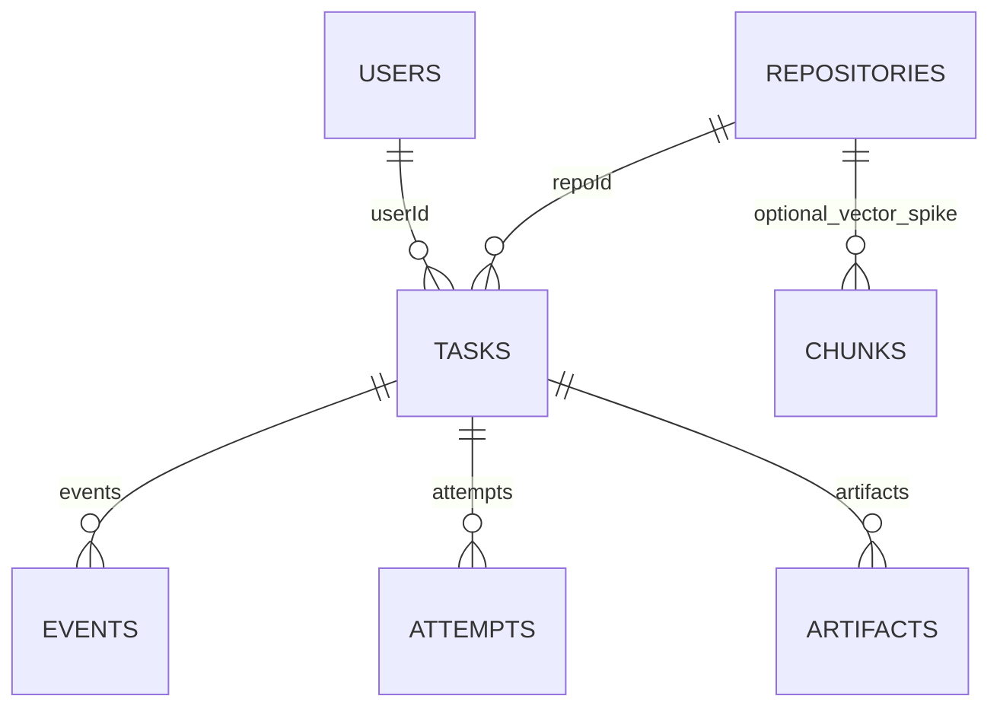

# GitResolve — Backend Schema

**Status:** Draft for review · **Version:** 1.0 · **Source contract:** PRD, TRD, AFD

## 1. Conventions

- **Database:** Firestore Native mode; no SQL joins or foreign keys.
- **Naming:** `camelCase` for Firestore fields and API JSON; enum values use `snake_case`.
- **Time:** Firestore `Timestamp` in storage; ISO-8601 UTC strings in API responses.
- **Versioning:** Top-level documents use `schemaVersion: 1`.
- **Access:** Only `backend/app/services/store/` accesses Firestore; routes and agent nodes use store functions.
- **Enums:** Defined once in `backend/app/schemas/enums.py`; frontend types generated from FastAPI OpenAPI.
- **Optional fields:** Omitted or `null` per schema; omit `leaseExpiresAt` when a task has no lease.

## 2. Collections and Relationships



| Path | Document ID |
|---|---|
| `users/{userId}` | GitHub numeric user ID as string |
| `repositories/{repoId}` | `{installationId}_{githubRepoId}` |
| `tasks/{taskId}` | `tsk_` + 20 hex chars; derived from user + idempotency key when supplied |
| `tasks/{taskId}/events/{seq}` | Zero-padded sequence, e.g. `000018` |
| `tasks/{taskId}/attempts/{n}` | Three-digit attempt number, e.g. `002` |
| `tasks/{taskId}/artifacts/{artifactId}` | Deterministic ID, e.g. `attempt_002_diff` |
| `repositories/{repoId}/chunks/{chunkId}` | Vector-search experiment only |

- `tasks.userId` is immutable and is the sole task-ownership authority.
- Tasks copy `repoFullName`, `installationId`, and `defaultBranch` so they remain readable if a repository cache entry disappears.
- `users.activeTaskId` tracks the user's active task; update it atomically with task transitions.
- Repository access is verified with GitHub, never authorized from cached `ownerUserIds`.

## 3. Document Schemas

### `users/{userId}`

- `githubUserId` (number), `githubLogin` (string), `avatarUrl` (optional string).
- `installationIds` (number[], max 50), `activeTaskId` (string or null).
- `createdAt`, `lastLoginAt` (timestamps), `schemaVersion` (number).
- **Never store:** email, GitHub user tokens, OAuth secrets.

### `repositories/{repoId}` — lightweight cache

- `installationId`, `githubRepoId` (numbers); `fullName`, `defaultBranch` (strings).
- `private` (boolean), `language` (optional string or null), `ownerUserIds` (optional hint only).
- `updatedAt` (timestamp), `schemaVersion` (number).
- `index` and `chunks` are excluded from MVP unless vector search is approved after benchmarking.

### `tasks/{taskId}` — central document

- **Identity:** `userId`, `repoId`, `repoFullName`, `installationId`, `defaultBranch`, `baseSha`.
- **Issue:** `issue = {number, title, url, body, bodyTruncated, labels[], comments[]}`.
- **Lifecycle:** `status`, `stage`, `statusUpdatedAt`, `createdAt`, `updatedAt`, `startedAt`, `finishedAt`.
- **Worker dispatch:** `dispatchPending`, `dispatchPhase` (`plan | execute | pr | null`), `dispatchAt`.
- **Cancellation/lease:** `cancelRequested`, optional `cancelRequestedAt`, `leaseOwner`, `leaseExpiresAt`, `heartbeatAt`.
- **Planning/testing:** `plan`, `testCommand`, `baseline`, `reproduction`.
- **Budgets:** `attempts = {used, max}`; `budgets = {modelCalls, inputTokens, outputTokens, execSeconds}`.
- **Immutable task limits:** `limits = {maxRepairAttempts, maxModelCalls, taskTimeoutSeconds, executionTimeoutSeconds, maxDiffFiles, maxDiffLines}`.
- **Approval:** `finalDiffHash`, `finalDiffSummary`, `approval = {state, by, at, diffHash}`.
- **Outcome:** `failure = {code, message, phase, retryable}`, `result`, `pr = {number, url, branch, createdAt}`.
- **Retention:** `deadlineAt`, `expiresAt`, `schemaVersion`.
- `plan`, `baseline`, `reproduction`, `finalDiffSummary`, `failure`, `result`, and `pr` are structured maps; optional values may be null.
- `pr` is written only after GitHub confirms PR creation.
- Keep task-document writes to lifecycle/stage transitions, 30-second lease heartbeats, and budget flushes at stage boundaries. Write frequent activity to events.

### `tasks/{taskId}/events/{seq}` — timeline

- `seq` (number), `ts` (timestamp), `stage`, `type`, `level` (`info | warn | error`).
- `message` (redacted, max 500 chars); `data` (typed map, max 2 KB); `expiresAt`.
- Event types include status/stage changes, tool/LLM metadata, tests, policy checks, attempts, approvals, PR creation, cancellation, and errors.
- Never store prompts, model responses, source files, environment values, or tokens in events. LLM events contain metadata only.
- Maximum 500 events/task; after 450, keep only high-value status, error, policy, and attempt events.
- One event writer at a time: worker while leased; otherwise API inside the transition transaction.

### `tasks/{taskId}/attempts/{n}` — one per repair attempt

- `n`, `status` (`running | passed | failed | errored`), `startedAt`, `finishedAt`.
- `diffHash`, `diffArtifactId`, `applyOk`, `filesChanged`, `linesAdded`, `linesRemoved`, `reproPassed`.
- `tests = {command, ran, passed, failed, newFailures[], durationMs, timedOut}`.
- `policy = {ok, violations[]}`, `failureDigest` (max 4 KB), `usage`, `expiresAt`.
- Maximum attempts is copied from the task's immutable `limits`.

### `tasks/{taskId}/artifacts/{artifactId}`

- Allowed IDs/types: `plan`, `repro_test`, `attempt_00N_diff`, `attempt_00N_tests`, `final_diff`, `final_tests`.
- Fields: `type`, `attempt`, `contentType`, `content`, `sizeBytes`, `truncated`, `sha256`, `createdAt`, `expiresAt`.
- Content is redacted plain text, max 256 KB/artifact. `final_diff` is the exact diff used to create the PR; its hash matches `finalDiffHash`.
- Artifacts follow task access control and are never logged.

## 4. Task Lifecycle

### `status` values

- **Active:** `queued`, `planning`, `running`, `creating_pr`.
- **Human gate:** `awaiting_start`, `awaiting_approval`.
- **Success:** `completed`.
- **Stopped:** `needs_input`, `rejected`, `cancelled`.
- **Failure:** `failed_not_reproduced`, `failed_no_fix`, `failed_policy`, `failed_budget`, `timed_out`, `failed_infra`, `worker_lost`.
- `failed_infra` and `worker_lost` may re-enter `creating_pr` only when `failure.phase == "pr"` and the user retries approval.

### `stage` values and flow

```text
intake → plan → setup → baseline → locate → reproduce
      → patch ↔ test → evaluate → policy_gate → awaiting_approval
      → pr → completed
```

- `stage` is progress/display information, never an authorization check.
- Patch/test/evaluate may repeat up to `limits.maxRepairAttempts`.
- Human gates are mandatory: plan → user starts repair; validated diff → user approves/rejects.
- `creating_pr` is not cancellable. PR retries reuse the task's deterministic branch.

### Failure codes

- `issue_ambiguous`, `not_reproduced`, `no_fix_found`, `policy_violation`, `budget_exceeded`, `timeout`.
- Infrastructure: `github_rate_limited`, `github_error`, `access_revoked`, `llm_unavailable`, `sandbox_error`, `internal_error`, `worker_lost`.
- `retryable` means a new task can be run; same-task PR retry is allowed only for `failure.phase == "pr"`.

## 5. Transaction and Dispatch Rules

- Create task atomically with `users.activeTaskId`; reject duplicate `Idempotency-Key` by using it to derive the task document ID and creating with `create()`.
- Active-slot statuses are `queued`, `planning`, `running`, `creating_pr`; human-waiting statuses release the slot.
- `start` and `approve` re-acquire the active slot; return `409` if occupied.
- Worker queue uses `dispatchPending == true`, plus `dispatchPhase` to indicate `plan`, `execute`, or `pr` work.
- Every transition validates the current state and updates task + user active slot in one transaction.
- Approval must match the stored `finalDiffHash`; never create a PR from a changed diff.
- A task requested by a different user returns `404`, same as a nonexistent task.

## 6. API and Validation Contract

- API responses use explicit Pydantic allow-list models; never return raw Firestore documents.
- Validation failures use the shared `400` error format, not FastAPI's default `422`.
- Important validation: positive `issueNumber`; `repoId` matches `^\d+_\d+$`; `diffHash` matches `^sha256:[0-9a-f]{64}$`; page `limit` 1–50; `after >= 0`.
- Repository access is checked against GitHub installations before task creation.
- Do not expose internal fields such as `installationId`, `dispatch*`, `lease*`, `expiresAt`, tokens, or other users' IDs in API responses.

## 7. Security and Data Boundaries

- Firestore Security Rules deny all client read/write access; server identity is governed by IAM.
- JWT signature, expiry, and `sub = userId` are checked on every request.
- Task routes must use `get_task_for_user(taskId, userId)` before reading task subcollections.
- Worker mints installation tokens from the GitHub App identity; it does not receive a user's GitHub token.
- Redact tokens, keys, authorization headers, and private-key blocks; strip ANSI/control characters before storage.
- Never store credentials, user email, full repository archives/source, raw prompts/responses, full command logs, environment variables, or redacted secrets.

## 8. Indexes and Allowed Queries

- **Composite index:** `tasks(userId ASC, createdAt DESC)` for paged task lists and daily quota count.
- **Automatic indexes:** `tasks.dispatchPending`, `tasks.leaseExpiresAt`, `events.seq`.
- **Vector index:** `chunks.embedding` only if vector-search experiment is adopted.
- No MVP index on `repositories.ownerUserIds` or `tasks(status, createdAt)`.
- Allowed queries: user's tasks newest-first; user's task count since UTC midnight; pending dispatch tasks; expired leases; events after a sequence number.
- `leaseExpiresAt` is omitted when unleased, so only leased tasks match the reaper's expiry query.

## 9. Retention and Size Limits

| Data | Retention |
|---|---|
| Tasks | 90 days after creation |
| Events, attempts, artifacts | 30 days after task creation |
| Users | Until manual deletion; in-app deletion deferred |
| Repository cache | Overwritten on use |
| Vector chunks | Delete on re-index/disconnect; optional feature |

- Enable Firestore TTL on `tasks`, `events`, `attempts`, and `artifacts` `expiresAt` fields.
- TTL deletion is asynchronous and does not cascade. API treats expired documents as `404` regardless of physical deletion.
- Firestore document guard: 900 KB (platform max 1 MiB); issue body 20 KB; up to 10 comments × 2 KB; up to 20 labels.
- Plan max 8 KB; event message 500 chars/data 2 KB; 500 events/task; artifact 256 KB each, 20 artifacts and 2 MiB/task.
- Store only the last ~200 lines of relevant failing-test output; never full install/run logs.
- Baseline failure IDs max 200; new failure IDs max 50; task writes throttled to about one per second/document.

## 10. Acceptance Checks

- Enums are defined once; generated frontend types match OpenAPI.
- Test every valid transition and verify invalid transitions return `409 invalid_state`.
- Concurrent approvals create one PR; cancellation/worker-claim races end in one valid state.
- `activeTaskId` matches active task state, including after worker crashes/reaper recovery.
- Cross-user task access returns the same `404` response as a nonexistent ID.
- Duplicate idempotency keys create only one task; unauthorized repositories are rejected.
- API allow-list prevents internal fields from leaking; API/worker writer permissions remain separated.
- Size limits, TTL behavior, deny-all rules, event pagination, and PR retry idempotency are covered by tests.

## 11. Open Decisions to Confirm

- Confirm proposed amendments: attempts subcollection, `stage`, `dispatchPending`, idempotency-derived task ID, active-slot rules, PR retry, and artifact field names.
- Daily quota window: UTC midnight recommended; display reset as 05:30 IST.
- Keep status filtering client-side for MVP; revisit if the first 50 tasks hide relevant tasks.
- Repository “last task status” column is out of MVP; consider denormalized `lastTask` in V2.
- Start with 60-second reaper interval, 90-second lease, and 30-second heartbeat; tune after end-to-end runs.
