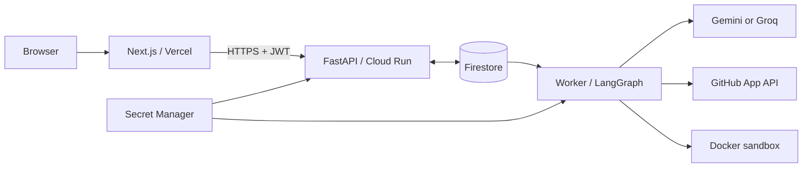
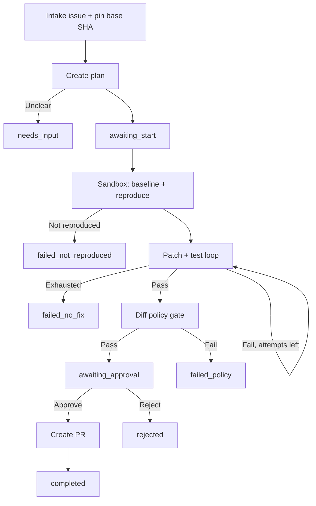

# GitResolve — Technical Requirements Document
- **Version:** 1.1 · Draft for review · Doc 2 of 6
- **Scope authority:** `docs/PRD.md` (frozen); this document must not add product scope.
- **Status labels:** `REQUIRED` MVP requirement · `DECISION` locked choice · `OPEN` team decision needed · `DEFERRED` out of MVP · `UNKNOWN` not verified.

## 1. Decisions at a glance
- **Frontend:** Next.js, React, TypeScript, Tailwind; deploy to Vercel (`gitresolve.vercel.app`, availability to verify).
- **API:** Python + FastAPI on Google Cloud Run.
- **Agent:** LangGraph; LangChain only when useful; Gemini primary, optional Groq fallback.
- **Persistence and queue:** Firestore Native mode, `(default)` database, `asia-south1` (verify region availability before creation).
- **Retrieval:** lexical search first; Firestore vector search only if a benchmark proves useful.
- **GitHub:** GitHub App; no personal access tokens or webhooks in MVP.
- **Secrets:** Secret Manager in production; secret-only `.env.example` for local development.
- **Execution:** separate worker controls Docker sandbox. Never execute repository code inside the API or worker process.
- **PR safety:** explicit approval of the exact diff before branch/commit/PR creation. Never auto-merge.

### Key conflict resolutions
- Resume only at `awaiting_start` / `awaiting_approval`; mid-run crash becomes `worker_lost`, and user reruns.
- Cloud Run cannot host the Docker daemon; worker runs locally for development or optionally on one GCE VM.
- Frontend/API use a 60-minute Bearer JWT because they have different domains; HttpOnly cookie session is a future option.
- The worker uses Firestore for the MVP queue; Redis, Celery, Kafka, Pub/Sub and Cloud Tasks are not included.

## 2. Architecture



### Component boundaries
- **Frontend:** login flow, repository/issue picker, task dashboard, plan review, diff/test review, approve/reject. No secrets or GitHub tokens.
- **API:** authentication, validation, authorization, task CRUD, event/artifact reads, quotas. Does not run the agent loop or repository code.
- **Firestore:** users, repositories/index metadata, task state, queue, events, artifacts, optional vectors. No credentials, full repositories or unbounded logs.
- **Worker + sandbox:** worker runs graph/LLM/GitHub orchestration; untrusted code runs only in isolated containers with no secrets or Docker socket. Test phase has no network.

### Async task lifecycle
1. `POST /tasks` creates `queued` task and returns `202` promptly.
2. Worker listens for queued tasks (snapshot listener; 15-second polling fallback is acceptable).
3. Worker claims task transactionally; stores lease owner/expiry and renews lease every 30 seconds.
4. UI polls task events every 3 seconds while active; stops at waiting or terminal states. SSE is deferred.

## 3. Repository layout

```text
GitResolve/
├── frontend/src/{app,components,features,lib,types}/
├── backend/app/{api,core,schemas,services,agent,worker}/
├── backend/tests/{unit,integration,security}/
├── backend/{Dockerfile,pyproject.toml}
├── sandbox/{Dockerfile,README.md}
├── docs/{PRD.md,TRD.md}
├── scripts/{create-indexes.sh,seed-demo-repo.sh}
└── .github/workflows/ci.yml
```

- One backend image has API and worker entrypoints; the sandbox has its own minimal image.
- Firestore access belongs only in `services/store/`.

## 4. Agent workflow



### Workflow rules
- Model proposes; deterministic code validates. Tests—not model confidence—determine success.
- The bug must reproduce: regression test fails before patch and passes after it.
- Record state transitions, tool calls, test outcomes and failures as events.
- Store state on the Firestore task document; no LangGraph checkpointer. Runs stop at `awaiting_start`, `awaiting_approval`, and after PR creation.

### Main nodes
- `intake` / `plan`: bound issue, pin `base_sha`, create structured plan or mark `needs_input`.
- `setup` / `baseline` / `locate`: sandbox clone, install, record baseline tests and retrieve candidate files.
- `reproduce` / `patch` / `evaluate`: regression test must fail before fix; validate diff and rerun tests within limits.
- `policy_gate` / `create_pr`: deterministic path/size checks, store hash, reapply approved diff at pinned SHA.

### Limits and statuses
- **Limits:** 3 repair attempts · 25 model calls/task · 20 minutes/task · 300 seconds/sandbox command · 40 file reads/task · 40 KB/file read · send at most ~200 failure-output lines to model.
- **Success path:** `queued → planning → awaiting_start → running → awaiting_approval → creating_pr → completed`.
- **Other states:** `needs_input`, `failed_not_reproduced`, `failed_no_fix`, `failed_policy`, `failed_budget`, `timed_out`, `failed_infra`, `worker_lost`, `cancelled`, `rejected`.
- Enforce all limits in code, not prompts. State transitions use Firestore transactions.

## 5. API contract
- **Base path:** `/api/v1` · JSON requests/responses.
- **Error shape:** `{"error":{"code":"...","message":"..."}}`.
- **Auth:** backend completes GitHub OAuth and issues a signed 60-minute JWT. Redirect token in URL fragment; frontend stores it in memory + `sessionStorage` and sends `Authorization: Bearer <jwt>`.
- **JWT trade-off:** JavaScript can read it if XSS occurs. Use strict CSP; render diffs as text, never untrusted HTML.
| Method + path | Purpose |
|---|---|
| `GET /health` | Liveness; no auth |
| `GET /auth/github/{login,callback}` | Sign-in flow |
| `GET /me` · `GET /repositories` | User and accessible repos |
| `GET /repositories/{repoId}/issues?state=open` | List open issues |
| `POST /tasks` · `GET /tasks` · `GET /tasks/{id}` | Create/list/read tasks |
| `POST /tasks/{id}/start` · `/cancel` | Start or cancel task |
| `GET /tasks/{id}/events` | Paginated timeline |
| `GET /tasks/{id}/artifacts[/{artifactId}]` | Read plan, diffs and test excerpts |
| `POST /tasks/{id}/approve` · `/reject` | Approve exact hash / reject fix |
| `POST /repositories/{repoId}/index` | Optional vector experiment |

### Core payloads

```json
// POST /tasks
{"repoId":"<installationId>_<githubRepoId>","issueNumber":42}
// POST /tasks/{id}/approve
{"diffHash":"sha256:<hash>"}
```

Task response includes: `id`, `status`, `stage`, repo/issue metadata, attempt and budget counts, reproduction result, test result, and PR metadata. `pr` remains null until GitHub confirms creation. Use `Idempotency-Key` on task creation.

### Required API protections
- Every request checks repository installation access and task ownership; Pydantic rejects unknown fields and bodies over 64 KB.
- Quotas: one active task/user and 10 tasks/user/day; add per-IP/per-user rate limits.
- CORS: production `https://gitresolve.vercel.app` only; localhost in development. No wildcard/preview origins; app-level auth remains mandatory.

## 6. Firestore data model
- Server SDK only; Firestore rules deny client access. Use `(default)` Native database in `asia-south1` after verifying availability.
- Never store tokens, full repositories/logs or source text in chunk docs. Throttle task writes; put timeline entries in subcollections.
```text
users/{githubUserId}
  githubLogin, avatarUrl, installationIds[], createdAt, lastLoginAt
repositories/{installationId}_{githubRepoId}
  ownerUserIds[], fullName, defaultBranch, index metadata
  └── chunks/{chunkId}                 # vector experiment only
      path, line range, symbol, language, commitSha, contentHash, embedding
tasks/{taskId}
  userId, repoId, issue, baseSha, status, stage, plan, reproduction,
  attempts, budgets, baseline, finalDiffHash, approval, result, pr,
  leaseOwner, leaseExpiresAt, cancelRequested, idempotencyKey, timestamps
  ├── events/{seq}: timestamp, stage, type, short message, small data
  └── artifacts/{artifactId}: type, attempt, truncated content, sha256
```

- Document limit: 1 MiB; artifact limit 256 KB; event message limit 500 characters.
- Retention: events/artifacts 30 days; tasks 90 days; delete chunks on re-index/disconnect. TTL must be configured per collection group and requires billing.

### Retrieval decision: benchmark before vector search
- `CodeRetriever.search(repo_id, query, k)` returns file/range candidates and scores.
- **Default lexical:** issue keywords/identifiers, stack-trace paths, `ripgrep`, Python AST symbol search, then model reranks top candidates.
- **Vector spike:** Firestore native vector search; embedding model generates vectors (Firestore does not generate embeddings). Proposed default dimension 768; chunk Python by function/class, fallback to 60-line windows with 10-line overlap; cap 3,000 chunks/repo.
- Compare lexical/vector/hybrid on seeded bugs plus 10–15 SWE-bench Lite tasks; measure recall@5/@10, latency and reads/writes.
- Adopt vector/hybrid only if it materially improves recall under a team-agreed threshold; otherwise ship lexical only. Time-box spike to one day.
- Firestore free quota reference for `(default)`: 50k reads/day, 20k writes/day, 20k deletes/day, 1 GiB storage, 10 GiB/month egress. Verify current billing/quotas before relying on these figures.

## 7. GitHub integration and PR gate
- GitHub App installed only on user-selected repositories.
- Read phase: metadata, contents and issues read. Write phase: contents + pull requests write, only after approval.
- Use short-lived installation tokens (about 1 hour), scoped to selected repositories and required permissions. Never store or send tokens to browser/sandbox.
- No Actions, Workflows, Administration or Secrets permissions.

### PR creation sequence
1. Transaction verifies status is `awaiting_approval` and submitted hash matches `finalDiffHash`.
2. Worker checks out pinned `base_sha` in a clean workspace and reapplies the stored approved diff.
3. Recompute hash; abort if it differs.
4. Create a unique `gitresolve/issue-{number}-{shortid}` branch, commit and PR to default branch.
5. Include issue link, summary, reproduction/test evidence, attempts and limitations in PR body.
6. Write `task.pr` only after GitHub confirms success. Keep approved diff if PR creation fails.
- Retry transient 5xx/network errors up to 3 times with backoff. Honor GitHub rate-limit headers; remint an installation token once on 401. Revoked access fails safely.
- Approval never implies merge. GitResolve does not auto-merge.

## 8. Sandbox security — REQUIRED
- Treat repository code, dependencies, tests, issue text and model patches as untrusted.
- Run code only in Docker containers controlled by the separate worker. Cloud Run does not run the Docker daemon.
- MVP execution: local Docker; optional dedicated GCE VM for hosted demo. Stronger isolation (gVisor/Kata/Firecracker/per-task VM) is deferred.
- Worker host has Docker socket access (root-equivalent): use a dedicated host with no unrelated secrets. Never mount socket into sandbox.

### Required container controls
- Non-root UID `10001`; drop all capabilities; `no-new-privileges`; read-only root filesystem.
- Writable paths: `/workspace` and tmpfs `/tmp`; limits: 2 GiB RAM/swap, 2 CPUs, 256 PIDs, 1 GB workspace.
- Kill commands after 300 seconds; remove containers; cap output at 1 MB and strip control characters.
- No secrets in env/mounts/images; network disabled during tests. Dependency installation has network access—use trusted repos only.
- Delete workspace at terminal state; retain at most 24 hours while awaiting approval.

### Deterministic diff gate
- Maximum 5 changed files and 150 changed lines.
- Block `.github/`, CI files, `.env*`, `.git*`, dependency manifests/lockfiles, symlinks, binaries, files over 100 KB and path traversal.
- Reject test deletion; existing test edits are allowed but flagged. Require a regression test for the reported bug.
- Validate paths and symlinks at every tool boundary. Model output is never trusted directly.

## 9. LLM integration and cost controls
- Interfaces: `LLMClient.generate_structured(...)` and `Embedder.embed(...)`.
- Adapters: Gemini primary; Groq optional fallback. Keep provider/model configurable, not hard-coded.
- **Open decision:** Gemini API key (AI Studio) vs Vertex AI; decide early. Vertex uses service-account identity and may consume GCP credits.
- Per-call timeout 60 seconds; up to 2 retries on 429/5xx; optional Groq fallback only when explicitly enabled.
- Validate structured outputs with Pydantic; allow one JSON repair retry.
- Enforce call/token/time budgets in code and record usage per task.
- Prompt-injection controls:
  - Treat issue/file/test content as data, never as system instructions.
  - Model tools limited to search, bounded file reads, diff proposals and test requests.
  - No model tool for network access, secrets or GitHub writes.
  - Validate tool arguments and enforce diff gate + human approval independently of model behavior.

## 10. Secrets and configuration

### Secret-only `backend/.env.example`
- Keep **secrets only** here. Non-secret settings belong in deployment configuration or typed defaults in `backend/app/core/config.py`.
- Use placeholders locally; never commit real values. Production values belong in Secret Manager.
```dotenv
# Required
SESSION_JWT_SECRET=replace_with_random_32_plus_byte_secret
GITHUB_APP_CLIENT_SECRET=replace_with_dev_github_app_client_secret
GITHUB_APP_PRIVATE_KEY=replace_with_dev_github_app_private_key_pem
GEMINI_API_KEY=replace_with_dev_gemini_api_key

# Optional: only if Groq fallback is enabled
GROQ_API_KEY=replace_with_dev_groq_api_key
```

- IDs, project/database names, models, URLs, ports, limits and sandbox settings are **not secrets**. `NEXT_PUBLIC_API_BASE_URL` is public; configure it in Vercel.
- Production Secret Manager: `session-jwt-secret`, `github-app-private-key`, `github-app-client-secret`, `gemini-api-key`, optional `groq-api-key`.
- Use separate dev credentials. Ignore `.env*` except the example, `secrets/`, `*.pem` and service-account JSON. Never use `NEXT_PUBLIC_` for credentials.

### IAM
- `gitresolve-api` service account: Firestore data access, logging, and access only to API-required secrets.
- `gitresolve-worker` service account: required Firestore access plus only the LLM/GitHub secrets it needs; no deploy/admin roles.
- Prefer attached service accounts / Application Default Credentials over downloaded service-account keys.

## 11. Deployment
| Component | Target / settings |
|---|---|
| Frontend | Vercel project `gitresolve`; build with `next build`; configure public API URL |
| API | Cloud Run `asia-south1`; `backend/Dockerfile`; min instances 0, max 2, 512 MiB, 60-second request timeout; `GET /health` |
| Worker | Local machine for dev or one GCE VM for hosted demo; `python -m app.worker.runner`; Docker installed |
| Database | Firestore `(default)`, Native mode; scripted indexes; deny-all rules; TTL policies |
| Secrets/logs | Secret Manager; structured JSON logs in Cloud Logging |

### Manual deployment checklist
1. Create GCP resources, verify Firestore region, create least-privilege service accounts and GitHub App.
2. Add secrets to Secret Manager; deploy API; configure indexes, TTL, CORS and frontend URL.
3. Configure Vercel public API URL and deploy frontend; start worker and smoke-test a test repo.
4. Set budget alerts at 50%, 80% and 100% of available credits.
- CI runs lint and unit tests only. Workload Identity Federation and automated deployment are deferred.
- Cost controls: scale Cloud Run to zero, cap instances/logs, stop idle GCE VM, use local Docker for development, and benchmark before indexing vectors.
- GCP credits expire soon; do not assume ongoing zero-cost hosting. Check Billing → Credits and stop paid resources before credits expire.

## 12. Testing and observability
- **Unit/API:** diff gate, budgets, state transitions, auth/authorization, validation and cross-user access (`pytest`, FastAPI TestClient).
- **Store/agent:** Firestore transactions; mocked LLM/GitHub flows for success, retry, ambiguity and budget failure.
- **Sandbox/security:** network isolation, resource limits, no secrets, path escape and diff-gate tests.
- **GitHub/frontend/E2E:** token scope, PR payload/rate limits, component tests and one Playwright seeded-issue-to-PR flow.
- CI uses mocks only; real LLM/GitHub calls are limited to manual E2E and benchmarks.

### Failures and logs
- Worker lease expiry → `worker_lost`; user reruns. Mid-run resume is deferred.
- Cancellation sets `cancelRequested`; worker checks between nodes and kills active container.
- Transactional idempotency prevents duplicate task creation and duplicate approval/PR.
- Logs: structured JSON with severity, task ID, stage, event, duration and request ID. Redact credentials; do not log source code, diffs or issue bodies.
- Store bounded evidence and usage counters with each task; never expose raw stack traces or credentials to the UI.

## 13. Delivery plan (2–3 weeks)
1. **Setup (days 1–2):** monorepo, GCP/Firestore, GitHub App, seeded bugs; choose Gemini API vs Vertex.
2. **Foundations (days 3–7):** LLM/graph, sandbox, auth/repo/task APIs, Firestore.
3. **Vertical slice (days 8–14):** reproduce → patch → tests/retry → policy gate → `awaiting_approval`.
4. **Approval (days 15–19):** PR creation, quotas/security tests, deploy frontend/API and optional worker VM.
5. **Evaluation (days 20–21):** benchmark, optional vector spike, failure analysis and demo.
- Cut first: vector spike, then hosted worker VM, then SWE-bench. Never cut sandbox controls, diff gate or human approval.
- Original planning assumes three people: agent/LLM; sandbox/GitHub; frontend/API/auth. Reassign as team size requires.

## 14. Risks and deferred scope
- **Fix rate / LLM quotas:** seeded demo, honest benchmarks, provider abstraction and hard budgets.
- **Sandbox risk:** trusted repos, dedicated worker host; egress proxy/stronger isolation deferred.
- **Firestore/vector cost:** lexical default, benchmark gate, throttled writes and chunk caps.
- **Unexpected charges:** budget alerts; stop paid resources when credits end.
**Deferred:** multi-language support, webhooks/automatic issue processing, mid-run checkpoint resume, SSE/websockets, egress proxy, stronger sandbox isolation, per-task VMs, parallel agents, teams/RBAC, external vector DB, cost dashboard, account deletion endpoint, CI/CD auto-deploy, shared-domain cookie sessions.

## 15. Acceptance criteria
- [ ] Users can sign in and access only installed repositories; cross-user task access is denied.
- [ ] Task creation returns `202` and planning runs asynchronously.
- [ ] At least 3/6 seeded bugs reach `awaiting_approval` with a regression test that fails before and passes after.
- [ ] Attempt/model/time budgets and diff policy are enforced; test at least 8 diff-gate cases.
- [ ] Sandbox enforces network/resource limits, blocks path escapes and receives no secrets.
- [ ] No branch/PR without matching diff-hash approval; duplicate approval cannot create duplicate PRs.
- [ ] PR metadata is saved only after GitHub confirms creation.
- [ ] No credentials or full source appear in browser, logs, events or API responses.
- [ ] Production uses Secret Manager and service accounts; no key files committed or baked into images.
- [ ] Record vector-vs-lexical benchmark results and the adopt/skip decision.
